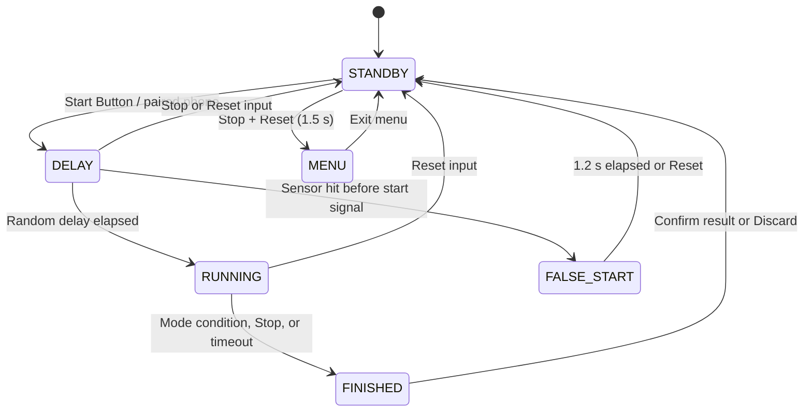

# EasySteel ESP32 Firmware

> 🌐 Language: **English** | [🇩🇪 Deutsch](de/FIRMWARE.md)

This document describes the design, state machine, and operation of the firmware. For electrical wiring, refer to [HARDWARE.md](HARDWARE.md); for the binding TCP contract, refer to [PROTOCOL.md](PROTOCOL.md).

## 1. System Boundary

The ESP32 is the authoritative system for round state, start signal, timing, hits, misses, penalties, result confirmation, and reset. A connected desktop application may observe events, persist confirmed results, and acknowledge delivery. It must never control or override an active round. A physically released and PIN-paired phone is a separate Solo Training input source: it may request Start, Stop, Reset, and idle mode changes, while the ESP32 validates and executes every transition.

The hardware remains fully operational without Wi-Fi and without a desktop application. Network latency or errors must not block timing.

## 2. Firmware Structure

```text
.
├── include/
│   ├── core/       Round controller, scoring, display, menu, and storage
│   ├── hardware/   Buttons, sensors, LEDs, buzzer, and watchdog
│   └── network/    Wi-Fi, web/OTA, TCP protocol, and queues
├── src/
│   ├── main.cpp
│   ├── core/
│   ├── hardware/
│   └── network/
├── test/           Native Unity tests and hardware mocks
├── docs/
└── platformio.ini
```

| Module | Responsibility |
|---|---|
| [`round_controller`](../src/core/round_controller.cpp) | Round lifecycle, physical user inputs, hit processing, and result scoring |
| [`round_state`](../src/core/round_state.cpp) | Pure, natively testable state transitions including false-start handling |
| [`scoring_rules`](../src/core/scoring_rules.cpp) | Target selection and calculation of missing intermediate plates |
| [`round_result`](../src/core/round_result.cpp) | Strictly single-consumption confirmed or discarded round results |
| [`training_result`](../src/core/training_result.cpp) | Stable volatile snapshots for non-authoritative phone-local Solo Training history |
| [`sensor_isr`](../src/hardware/sensor_isr.cpp) | Hardware interrupts, debounce, crosstalk suppression, and chronological hit FIFO |
| [`display`](../src/core/display.cpp) | SH1106 OLED rendering, split views, menu UI, and screensaver |
| [`network`](../src/network/network.cpp) | Wi-Fi operational modes and coordination of HTTP, OTA, and TCP |
| [`remote_control`](../src/network/remote_control.cpp) | Physical PIN release, one-phone session, PC priority, timeouts, and bounded command slot |
| [`tcp_client`](../src/network/tcp_client.cpp) | Non-blocking event transmission, reconnection, and result ACK handling |
| [`storage`](../src/core/storage.cpp) | Persistent device configuration in ESP32 Preferences/NVS |

## 3. Round State Machine



### STANDBY

- Displays device / stage name, active round mode, ready status, and last round / reaction time. Network and IP diagnostics are available via the menu (**Menu → Network** / **Menu → Info**).
- Start initiates a random countdown delay between 1.0 and 4.0 seconds.
- A paired Solo Training phone may select the round mode or request Start. Start from `FINISHED` discards the pending official result and immediately begins the next local training run.
- Holding Stop and Reset together for 1.5 seconds opens the configuration menu.
- The screensaver dims the OLED after inactivity without disconnecting Wi-Fi or TCP.

### DELAY and FALSE_START

- Target sensors are armed immediately upon entering `DELAY`.
- Any sensor hit before the start beep triggers `FALSE_START`, plays an alert tone, and shows `FALSE START` on the display.
- After 1.2 seconds, the device returns automatically to `STANDBY`.
- Pressing Stop or Reset aborts the countdown; Reset also immediately terminates the false-start screen.

### RUNNING

- The display presents running time, progress bar, hit count, and target matrix.
- Green (Start) or Red (Stop) manually stops the round.
- Black (Reset) discards the active round and emits a `reset` event.
- The round ends automatically upon reaching the 30.0-second timeout.
- A sensor queue overflow invalidates the round; the firmware discards it and emits a `reset` event.

### FINISHED

The result remains strictly on the device for inspection by the Range Officer:

- Green short: Cycle through total time and chronological split times.
- Green long: Return to overall time view.
- Red short: Increment penalties (+3.0s per miss/penalty); rolls over back to minimum miss count after 10.
- Red long: Reset penalties to the automatically evaluated miss count.
- Black short: Commit and confirm the result, emitting exactly one `end` protocol event.
- Black long: Discard the result without scoring and emit a `reset` event.
- In Reaction Drill mode, Green confirms the previous result and immediately arms the next attempt.

The displayed result time (including penalties) is capped at 30.0 seconds. If the configured screensaver timeout expires while in `FINISHED`, the unconfirmed result is discarded and the timer transitions to `STANDBY`.

For a round started while a Solo Training phone is paired, the ESP32 publishes a stable volatile training result ID with raw/final time, mode, misses, hit mask, and chronological splits. The phone stores each ID exactly once in LocalStorage. Mobile Start begins the next run, and mobile Reset returns to `STANDBY`; neither action submits the pending result to the official result outbox.

## 4. Round Modes

| Mode | Completion Condition | Scoring Rules |
|---|---|---|
| Competition (*Wettkampf*) | First hit on Stop Plate or manual stop | Missing configured intermediate targets are scored as misses (+3.0s each) |
| All Targets (*Alle Ziele*) | All intermediate targets hit and Stop Plate hit last | No automated miss penalty since all targets are required to stop the timer |
| Reaction Drill (*Reaktions-Drill*) | First hit on any connected sensor | Reaction time to first hit, zero misses |

Sensor index `0` is always the Stop Plate. With a target count of `5`, indices `1` through `4` are intermediate plates. Hits on unconfigured targets are ignored outside Reaction Drill mode.

## 5. Hit Detection & ISR Architecture

All five target sensors are driven by hardware `RISING` interrupts. The ISR performs strictly bounded, time-critical tasks in IRAM:

1. Validate round state and target index.
2. Ignore duplicate intermediate target hits outside test mode.
3. Apply 50 ms per-target debouncing.
4. Apply 25 ms global crosstalk lockout across all sensors.
5. Push target index and `millis()` timestamp into a static 16-entry lock-free FIFO queue.

The main loop drains events chronologically and handles LEDs, buzzer patterns, display updates, scoring, and TCP serialization. Buffer overflow, dropped hits, and queue access are handled deterministically; display, logging, and networking never run in the ISR.

## 6. Networking, Web Portal & OTA

### Operational Modes

- **STA:** Connects to the configured LAN, serves the authenticated web settings portal, and connects to the desktop TCP server.
- **AP+STA Provisioning:** If no valid credentials exist, starts `EasySteel_XXXX` SoftAP with Captive Portal and background Wi-Fi scanning.
- **Offline:** The user can switch to standalone offline mode by pressing Stop during connection or after the boot grace period in provisioning.

The default TCP port is `53421`. Event framing and delivery semantics are detailed in [PROTOCOL.md](PROTOCOL.md).

### Mobile Solo Training

1. In `STANDBY`, open **Menu → Phone Training** on the ESP32.
2. The OLED displays a four-digit PIN for 60 seconds.
3. Enter the PIN on the training dashboard. Five invalid attempts close the pairing window.
4. Exactly one phone receives a RAM-only session token. Dashboard polling renews the 30-second inactivity lease.
5. Physical input clears any queued phone command. A desktop connection revokes the phone immediately; a new physical release is required after disconnect.

The dashboard exposes Start in `STANDBY` and `FINISHED`, Stop in `DELAY` and `RUNNING`, Reset in `DELAY`, `RUNNING`, and `FINISHED`, and mode selection only in `STANDBY`. HTTP handlers validate and enqueue one bounded command; the normal round-controller tick performs the action. During `DELAY`, the ESP32 reports its stable countdown ID and remaining time. The phone keeps the normal 200 ms polling rate and continuously updates an EWMA estimate of half the HTTP round-trip time from every successful state response. Each `DELAY` response reschedules the enabled **Beep** with the latest estimate. Network asymmetry and browser scheduling may still introduce jitter, so the ESP32 buzzer defines the actual start signal.

### Transmission & Queue Reliability

- Live events use a bounded static outgoing queue (16 messages) and are discarded if disconnected.
- Confirmed results use a separate 20-entry RAM outbox buffer.
- The outbox is volatile: reboot or power loss clears undelivered runs.
- If the outbox overflows, a new result replaces the oldest entry and logs a serial warning.
- The network loop executes at most one non-blocking socket write (`MSG_DONTWAIT`) per tick, preventing watchdog stalls.

### Security & OTA Updates

- The provisioning portal is accessible only on the password-protected SoftAP.
- Browser OTA is disabled during provisioning.
- In Station mode, settings and browser OTA require HTTP Basic Authentication (`admin` + device password).
- Solo Training control requires physical four-digit PIN release plus a strong volatile session token; the token is accepted from exactly one phone and is never stored in NVS.
- OTA updates are processed strictly when the round controller is in `STANDBY`.
- Task Watchdog and sensor interrupts are safely disabled during flash writes and restored on every exit and error path.

Basic authentication is intended for a trusted range network. Signed binaries are recommended for high-security environments.

## 7. Persistent Configuration (NVS)

| Namespace | Key | Description |
|---|---|---|
| `wifi` | `ssid`, `pass` | Wi-Fi network credentials |
| `device` | `name`, `serverIp`, `port` | Device name and desktop TCP endpoint |
| `easysteel` | `targets` | Configured target plate count |
| `easysteel` | `require_all` | Compatibility setting for All Targets mode |
| `easysteel` | `game_mode` | Persistent legacy key for active round mode |
| `easysteel` | `screensaver` | OLED timeout in minutes |

The key `game_mode` is deliberately retained to preserve stored settings across firmware updates.

Holding the Reset button for 2.0 seconds during boot clears Wi-Fi credentials only; device settings and target configurations are preserved.

## 8. Core Constants

| Constant | Value | Source |
|---|---:|---|
| `ROUND_TIMEOUT_MS` | 30,000 ms | [`config.h`](../include/core/config.h) |
| `START_DELAY_MIN_MS` | 1,000 ms | `config.h` |
| `START_DELAY_MAX_MS` | 4,001 ms, exclusive | `config.h` |
| `FALSE_START_DISPLAY_MS` | 1,200 ms | [`round_state.h`](../include/core/round_state.h) |
| `SENSOR_DEBOUNCE_DELAY_MS` | 50 ms | `config.h` |
| `GLOBAL_CROSSTALK_LIMIT_MS` | 25 ms | `config.h` |
| `MENU_HOLD_MS` | 1,500 ms | `config.h` |
| `WIFI_CONNECT_TIMEOUT_MS` | 4,000 ms | `config.h` |
| Heartbeat Interval | 10,000 ms | [`tcp_client.cpp`](../src/network/tcp_client.cpp) |
| Reconnect Retry | 15,000 ms | `tcp_client.cpp` |

## 9. Build & Quality Assurance

Run from the repository root:

```powershell
pio test -e native
pio run -e esp32dev
pio check -e esp32dev --skip-packages
```

Native test suites verify button debouncing, sensor ISR queueing, chronological ordering, round state transitions, miss calculations, single-consumption results, persistent storage, protocol serialization, live queues, and the result outbox.

Compiled firmware binaries are output to `.pio/build/esp32dev/firmware.bin`.
