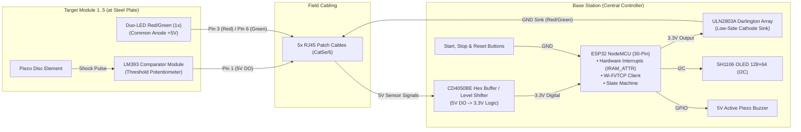

# EasySteel Hardware Specification

This document is the authoritative hardware reference for the base station, target modules, pinouts, and field cabling. Do not construct systems from older, simplified sketches.

> ⚠️ **MANDATORY PRE-COMMISSIONING CHECKS:**
> Before initial power-up, perform a multimeter continuity test to verify there is no short circuit between 5 V, 3.3 V, and GND rails. Next, with the ESP32 removed from its socket, apply a regulated 3.30 V (±0.05 V) supply (from the expansion base-board 3.3V regulator or an external bench supply with common GND) to the 3.3V rail (CD4050BE Pin 1). Verify that applying 5.0 V at each RJ45 sensor input produces <= 3.40 V at the corresponding CD4050BE output pin (strict ESP32-safe limit <= 3.60 V) and <= 0.05 V at grounded Pin 14. Never apply 5 V directly to an ESP32 GPIO pin.

---

## 1. System Architecture & Signal Flow

The system comprises a central **Base Station (ESP32 Controller)** and up to **5 Target Modules (Steel Plates)** connected via standard **RJ45 patch cables**.



---

## 2. Bill of Materials (BOM)

### A. Base Station (Central Controller)

| Component | Qty | Description / Specification |
|---|:---:|---|
| **ESP32 NodeMCU** | 1x | 30-pin variant with expansion base board (set power jumper to 5V) |
| **CD4050BE IC** | 1x | Texas Instruments Hex non-inverting CMOS buffer / down-converter (DIP-16) |
| **GS 16 Socket** | 1x | 16-pin IC socket (2.54 mm pitch, 7.62 mm row spacing) for CD4050BE |
| **KERKO 100N** | 1x | 100 nF ceramic decoupling capacitor across CD4050BE VCC (Pin 1) and GND (Pin 8) |
| **ULN2803A IC** | 1x | 8-channel Darlington transistor array for low-side cathode switching |
| **H25SR160 Board** | 1x | FR4 stripboard (2.54 mm grid) for controller shield wiring |
| **RJ45 Breakout Boards** | 5x | 8P8C RJ45 breakout jacks for Target 1 to 5 cables |
| **OLED Display** | 1x | SH1106, 128×64 pixels, I2C, address `0x3C`, 3.3V compatible |
| **Push Buttons** | 3x | Momentary NO: Green (Start), Red (Stop/Penalty), Black (Reset/Score) |
| **Buzzer** | 1x | 5V active piezo buzzer (start tone and acoustic feedback) |
| **Power Supply** | 1x | 9V / 12V DC power supply connected to base board barrel jack |

### B. Per Target Module (Target 1 to 5)

| Component | Qty | Description / Specification |
|---|:---:|---|
| **LM393 Sensor Module** | 1x | Comparator module with digital output (DO). *Note: Desolder original onboard buzzer.* |
| **Piezo Disc** | 1x | 20mm–27mm bare piezo element soldered directly to LM393 buzzer pads |
| **Duo-LED Red/Green** | 1x | **Common Anode (+)**. Recommended: 10mm diffused for distance visibility |
| **Series Resistor Red** | 1x | **~100 Ω** for the red cathode |
| **Series Resistor Green** | 1x | **~56 Ω** for the green cathode |
| **RJ45 Breakout Board** | 1x | RJ45 socket inside the target enclosure for patch cable connection |

> **Note on LED series resistors:** `100 Ω` for Red and `56 Ω` for Green are tested values from the reference hardware build. For different LED models, batches, or supply voltages, verify forward voltage and current limits from the datasheet and measure operating current on the assembled target.

---

## 3. RJ45 Pin Assignment (Ports 1 to 5)

Each target connects to the base station via a standard 8-conductor network cable (Cat5e / Cat6):

```
                          RJ45 Jack / Plug
                       ┌─────────────────────────┐
                       │  1  2  3  4  5  6  7  8 │
                       └──┴──┴──┴──┴──┴──┴──┴──┴─┘
```

| RJ45 Pin | Color Code (T568B) | Signal | Function & Wiring |
|:---:|---|---|---|
| **Pin 1** | White / Orange | **Sensor Signal (5V DO)** | Digital output from LM393 (with onboard 10kΩ pull-up) $\rightarrow$ CD4050BE (Inputs 1A..5A, Pins 3, 5, 7, 9, 11) |
| **Pin 2** | Orange | **GND** | Common ground (bridged to Pin 7+8) $\rightarrow$ LM393 GND |
| **Pin 3** | White / Green | **Red Signal (Cathode)** | Switched ground from ULN2803A OUT 1 $\rightarrow$ Resistors (~100Ω) $\rightarrow$ Red Cathodes |
| **Pin 4** | Blue | **+5V Supply** | Common positive (bridged to Pin 5) $\rightarrow$ LM393 VCC & Common LED Anodes |
| **Pin 5** | White / Blue | **+5V Supply** | Bridge to Pin 4 (for higher current capacity) |
| **Pin 6** | Green | **Green Signal (Cathode)** | Switched ground from ULN2803A OUT 2..6 $\rightarrow$ Resistors (~56Ω) $\rightarrow$ Green Cathodes |
| **Pin 7** | White / Brown | **GND** | Bridge to Pin 2 |
| **Pin 8** | Brown | **GND** | Bridge to Pin 2 |

---

## 4. Schematics & Wiring

### 4.1 Target Module (Wiring at Steel Plate)

```
======================================================================
RJ45 [Pins 4+5 bridged] (+5V)
 │
 ├───> LM393 Module [VCC Pin]
 └───> [Duo-LED Anode / Common Pin +]

RJ45 [Pins 2+7+8 bridged] (GND)
 │
 └───> LM393 Module [GND Pin]

RJ45 [Pin 1] (Sensor DO)
 │
 └───> LM393 Module [DO Pin]  (Piezo disc soldered to buzzer pads, onboard 10kΩ pull-up to 5V)

RJ45 [Pin 3] (Red signal from ULN2803A)
 │
 └───> [ ~100 Ω ] ───> [Duo-LED Red Cathode -]

RJ45 [Pin 6] (Green signal from ULN2803A)
 │
 └───> [ ~56 Ω ] ───> [Duo-LED Green Cathode -]
======================================================================
```

---

### 4.2 Base Station

#### 1. Sensor Level Shifting with CD4050BE

The 5V digital outputs from the LM393 sensor modules pass through a Texas Instruments CD4050BE CMOS Hex Non-Inverting Buffer to the 3.3V ESP32 inputs. Powered at 3.3V ($V_{CC}$), the CD4050BE accepts 5V input levels without distortion and actively drives push-pull 3.3V signals to the ESP32 GPIOs with sub-microsecond propagation delay (~30–70 ns).

A 100 nF ceramic decoupling capacitor (KERKO 100N) must be placed directly across Pin 1 ($V_{CC}$) and Pin 8 ($V_{SS}$/GND). Unused channel 6 input (Pin 14) must be tied to GND to prevent CMOS input floating; output Pin 15 is left unconnected. Pins 13 and 16 are internal no-connects (NC).

```
                            CD4050BE (DIP-16)
                             ┌───────∪───────┐
  (+3.3V ESP32 + 100nF) VCC ─[ 1          16 ]─ NC (Not Connected)
   (→ ESP32 Pin 32 Stop) 1Y ─[ 2          15 ]─ 6Y (NC / Spare Output)
   (← RJ45 Port 1 Pin 1) 1A ─[ 3          14 ]─ 6A (Tie to GND)
   (→ ESP32 Pin 33 Tgt2) 2Y ─[ 4          13 ]─ NC (Not Connected)
   (← RJ45 Port 2 Pin 1) 2A ─[ 5          12 ]─ 5Y (→ ESP32 Pin 27 Tgt5)
   (→ ESP32 Pin 25 Tgt3) 3Y ─[ 6          11 ]─ 5A (← RJ45 Port 5 Pin 1)
   (← RJ45 Port 3 Pin 1) 3A ─[ 7          10 ]─ 4Y (→ ESP32 Pin 26 Tgt4)
                    GND VSS ─[ 8           9 ]─ 4A (← RJ45 Port 4 Pin 1)
                             └───────────────┘

  5V Signals from Targets         CD4050BE Buffer         3.3V Inputs on ESP32
  ───────────────────────         ───────────────         ────────────────────
  RJ45 Port 1 [Pin 1] (Stop) ───> Pin 3 (1A) ── Pin 2 (1Y) ───> ESP32 Pin 32 (Stop Plate)
  RJ45 Port 2 [Pin 1] (Tgt 2) ──> Pin 5 (2A) ── Pin 4 (2Y) ───> ESP32 Pin 33 (Sensor 2)
  RJ45 Port 3 [Pin 1] (Tgt 3) ──> Pin 7 (3A) ── Pin 6 (3Y) ───> ESP32 Pin 25 (Sensor 3)
  RJ45 Port 4 [Pin 1] (Tgt 4) ──> Pin 9 (4A) ── Pin 10 (4Y) ──> ESP32 Pin 26 (Sensor 4)
  RJ45 Port 5 [Pin 1] (Tgt 5) ──> Pin 11 (5A) ─ Pin 12 (5Y) ──> ESP32 Pin 27 (Sensor 5)
```

#### 2. LED & Buzzer Drivers (ULN2803A)

The ULN2803A sinks LED and buzzer cathodes to ground when the ESP32 drives the corresponding pin `HIGH`:

```
  GND Rail ───────────────> ULN2803A Pin 9  (GND)
  5V Rail ────────────────> ULN2803A Pin 10 (COM / Flyback Diodes)

  ESP32 Control Signal            ULN2803A Driver         Output to Target Wiring
  ────────────────────            ───────────────         ───────────────────────
  ESP32 Pin 4  (Global Red) ────> IN 1 ──── OUT 1 (P18) ─> ALL RJ45 Ports 1 to 5 [Pin 3]
  ESP32 Pin 19 (Green Target 1) > IN 2 ──── OUT 2 (P17) ─> RJ45 Port 1 [Pin 6]
  ESP32 Pin 18 (Green Target 2) > IN 3 ──── OUT 3 (P16) ─> RJ45 Port 2 [Pin 6]
  ESP32 Pin 5  (Green Target 3) > IN 4 ──── OUT 4 (P15) ─> RJ45 Port 3 [Pin 6]
  ESP32 Pin 17 (Green Target 4) > IN 5 ──── OUT 5 (P14) ─> RJ45 Port 4 [Pin 6]
  ESP32 Pin 16 (Green Target 5) > IN 6 ──── OUT 6 (P13) ─> RJ45 Port 5 [Pin 6]
  ESP32 Pin 23 (Buzzer) ────────> IN 7 ──── OUT 7 (P12) ─> Buzzer (-) Cathode
```

> **Buzzer on ULN2803A (Channel 7):** Designed for a 5V active buzzer. Connect anode to the protected 5V rail; cathode is sinked through ULN2803A. Passive speakers or 12V sirens are not supported in the standard design.

#### 3. Buttons & Display

```
  ESP32 Pin 14 ───────────> Button 1 (Start / Green) ───────> GND Rail (Active LOW)
  ESP32 Pin 12 ───────────> Button 2 (Stop/Penalty / Red) ──> GND Rail (Active LOW)
  ESP32 Pin 13 ───────────> Button 3 (Reset/Score / Black) ─> GND Rail (Active LOW)

  ESP32 Pin 21 (SDA) ─────> OLED Display SDA
  ESP32 Pin 22 (SCL) ─────> OLED Display SCL
  3.3V / GND ─────────────> OLED Display VCC / GND
```

---

## 5. ESP32 Pinout Overview

```
                         ┌───────────────┐
                         │     ESP32     │
                         │    30-Pin     │
                         │               │
                   EN ── [   EN     D23  ] ─→ ULN2803A IN 7 (Buzzer)
                 (VP) ── [   VP     D22  ] ─→ OLED SCL (I²C)
                 (VN) ── [   VN     TX0  ] ── (Serial TX Debug)
               (open) ── [  D34     RX0  ] ── (Serial RX Debug)
               (open) ── [  D35     D21  ] ─→ OLED SDA (I²C)
(CD4050 1Y / Port 1) IO32 ←─ [  D32     D19  ] ─→ ULN2803A IN 2 (LED Green 1)
(CD4050 2Y / Port 2) IO33 ←─ [  D33     D18  ] ─→ ULN2803A IN 3 (LED Green 2)
(CD4050 3Y / Port 3) IO25 ←─ [  D25      D5  ] ─→ ULN2803A IN 4 (LED Green 3)
(CD4050 4Y / Port 4) IO26 ←─ [  D26     D17  ] ─→ ULN2803A IN 5 (LED Green 4)
(CD4050 5Y / Port 5) IO27 ←─ [  D27     D16  ] ─→ ULN2803A IN 6 (LED Green 5)
     (BTN Start)  IO14 ←─ [  D14      D4  ] ─→ ULN2803A IN 1 (LED Global Red)
      (BTN Stop)  IO12 ←─ [  D12      D2  ] ── Built-in LED (Heartbeat)
     (BTN Reset)  IO13 ←─ [  D13     D15  ] ── (open)
                  GND ── [  GND     GND  ] ── Common Ground (GND)
                   5V ── [  VIN     3V3  ] ── 3.3V Output (to CD4050 VCC & OLED)
                         │               │
                         │   [  USB  ]   │
                         └───────────────┘
```

| Pin | Direction | Function | Connected Device / Signal |
|:---:|:---:|---|---|
| **GPIO 32** | Input (ISR) | **Sensor 1 (Stop Plate)** | CD4050BE 1Y $\leftarrow$ 1A $\leftarrow$ RJ45 Port 1 [Pin 1] |
| **GPIO 33** | Input (ISR) | **Sensor 2** | CD4050BE 2Y $\leftarrow$ 2A $\leftarrow$ RJ45 Port 2 [Pin 1] |
| **GPIO 25** | Input (ISR) | **Sensor 3** | CD4050BE 3Y $\leftarrow$ 3A $\leftarrow$ RJ45 Port 3 [Pin 1] |
| **GPIO 26** | Input (ISR) | **Sensor 4** | CD4050BE 4Y $\leftarrow$ 4A $\leftarrow$ RJ45 Port 4 [Pin 1] |
| **GPIO 27** | Input (ISR) | **Sensor 5** | CD4050BE 5Y $\leftarrow$ 5A $\leftarrow$ RJ45 Port 5 [Pin 1] |
| **GPIO 4**  | Output | **Global Red LED** | ULN2803A IN 1 $\rightarrow$ OUT 1 $\rightarrow$ ALL RJ45 [Pin 3] |
| **GPIO 19** | Output | **Green LED Target 1** | ULN2803A IN 2 $\rightarrow$ OUT 2 $\rightarrow$ RJ45 Port 1 [Pin 6] |
| **GPIO 18** | Output | **Green LED Target 2** | ULN2803A IN 3 $\rightarrow$ OUT 3 $\rightarrow$ RJ45 Port 2 [Pin 6] |
| **GPIO 5**  | Output | **Green LED Target 3** | ULN2803A IN 4 $\rightarrow$ OUT 4 $\rightarrow$ RJ45 Port 3 [Pin 6] |
| **GPIO 17** | Output | **Green LED Target 4** | ULN2803A IN 5 $\rightarrow$ OUT 5 $\rightarrow$ RJ45 Port 4 [Pin 6] |
| **GPIO 16** | Output | **Green LED Target 5** | ULN2803A IN 6 $\rightarrow$ OUT 6 $\rightarrow$ RJ45 Port 5 [Pin 6] |
| **GPIO 23** | Output | **Piezo Buzzer** | ULN2803A IN 7 $\rightarrow$ OUT 7 $\rightarrow$ Buzzer (-) |
| **GPIO 14** | Input (Pullup) | **Start Button (Green)** | Green Push Button $\rightarrow$ GND |
| **GPIO 12** | Input (Pullup) | **Stop/Penalty Button (Red)** | Red Push Button $\rightarrow$ GND |
| **GPIO 13** | Input (Pullup) | **Reset/Score Button (Black)**| Black Push Button $\rightarrow$ GND (Deep Sleep Wakeup) |
| **GPIO 21** | I2C | **OLED SDA** | Display SDA |
| **GPIO 22** | I2C | **OLED SCL** | Display SCL |

---

## 6. Electrical Dimensioning & Commissioning Checklist

Before field deployment, verify and log the following checks:

1. Continuity and short-circuit test across all 5V, 3.3V, and GND rails.
2. Supply voltage verification: Regulated $V_{CC} = 3.30\text{V} \pm 0.10\text{V}$ ($3.20\text{V}$ to $3.40\text{V}$) at CD4050BE Pin 1 (within ESP32 $3.0\text{V}$–$3.6\text{V}$ operating range); sensor supply $V_{in} = 5.00\text{V} \pm 0.25\text{V}$ at target modules.
3. Static logic level conversion on each channel with ESP32 detached (using expansion base-board 3.3V regulator or external 3.30V ±0.05V bench supply with common GND):
   - Input LOW $\le 0.50\text{V} \rightarrow$ Output LOW $\le 0.10\text{V}$.
   - Input HIGH $\ge 4.50\text{V} \rightarrow$ Output HIGH tracks measured $V_{CC}$ within CMOS saturation bounds: $(V_{CC} - 0.10\text{V}) \le V_{OH} \le V_{CC}$ ($3.10\text{V}$ to $3.40\text{V}$, strictly $\le 3.60\text{V}$ ESP32 maximum absolute limit).
   - Grounded unused Pin 14 (Channel 6A input) verified $\le 0.05\text{V}$.
4. Common ground between power supply, base station, and all target modules.
5. Separate series resistors for red and green cathodes of the Duo-LED.
6. Measure current draw per target module and total current with all LEDs illuminated.
7. Ensure power supply, wiring, connectors, and PCB traces have adequate safety margins and fuse protection on the 5V rail.
8. Clearly label RJ45 cables as EasySteel field wiring. They carry power and GPIO signals and must never be plugged into Ethernet equipment.
9. Verify strain relief, contact protection, weatherproofing, and impact shielding.
10. Dynamic cable and transient test with calibrated digital storage oscilloscope (DSO $\ge 20\text{ MHz}$) on $15\text{ m}$ Cat5e/6 field cable:
    - Peak transient voltage $V_{peak} \le 3.50\text{V}$ (minimum $100\text{ mV}$ margin below ESP32 $3.60\text{V}$ absolute maximum) and undershoot $V_{undershoot} \ge -0.20\text{V}$ relative to GND.
    - Quantitative trigger test across all 5 channels: 10 consecutive strikes per channel (50 strikes total) with zero duplicate hits outside the 50 ms debounce interval and zero false triggers on idle channels during adjacent channel strikes.

The current rating of an individual ULN2803A channel cannot be multiplied across all 8 channels without considering total thermal package dissipation and ambient temperatures.

## 7. Manufacturing Documentation Pending

The following production assets are tracked for future public releases:

- Verified schematic replacing the wiring illustration;
- PCB / perfboard layout with connector designations;
- Full pin-to-pin wiring diagram for both RJ45 ends and T568B compliance;
- Enclosure CAD models with strain relief and ballistic shielding;
- Defined maximum cable length and acceptance criteria (15 m Cat5e/6 field cable test specified in Section 6);
- Reference assembly photographs;
- Complete Bill of Materials with manufacturer part numbers.
