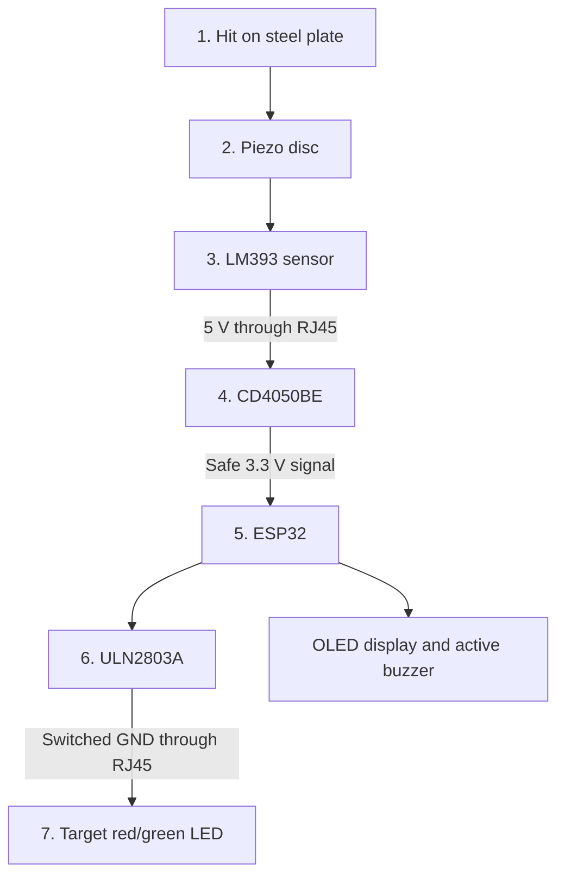

# EasySteel hardware and wiring guide

This guide describes the EasySteel reference hardware: one base station and up to five target modules. It is written for builders who can solder and use a multimeter. You do not need to understand the electronics behind every component.

The pin assignments in this guide match the current ESP32 firmware. Do not build from older sketches.

> **Important safety checks before switching on**
>
> - Disconnect power while assembling or changing wires.
> - Check with a multimeter that 5 V, 3.3 V, and GND are not shorted together.
> - Never connect a 5 V signal directly to an ESP32 pin. The five sensor signals must pass through the CD4050BE level shifter.
> - Label every EasySteel RJ45 cable. These cables carry power and control signals and must never be connected to Ethernet equipment.
> - Protect target electronics and cables from bullet fragments, direct hits, rain, and mechanical strain.

## 1. What the parts do

Each target contains a piezo disc that detects the vibration of a hit. An LM393 module turns that vibration into a digital signal. A red/green LED shows the target state.

The base station performs three jobs:

1. The **CD4050BE** reduces each 5 V sensor signal to a safe 3.3 V signal for the ESP32.
2. The **ESP32** runs the firmware and decides which LEDs and buzzer are active.
3. The **ULN2803A** switches the LEDs and buzzer. It keeps their current away from the ESP32 pins.



## 2. Parts list

### Base station

| Part | Quantity | Required details |
|---|:---:|---|
| ESP32 development board | 1 | 30-pin NodeMCU-style board |
| Compatible expansion base board | 1 | Must provide regulated 5 V and 3.3 V rails |
| CD4050BE | 1 | DIP-16, non-inverting level shifter |
| 16-pin IC socket | 1 | 2.54 mm pitch, 7.62 mm row spacing |
| 100 nF ceramic capacitor | 1 | Mounted directly between CD4050BE pins 1 and 8 |
| ULN2803A | 1 | DIP-18, eight-channel Darlington driver |
| H25SR160 stripboard | 1 | 2.54 mm grid, or an equivalent board |
| RJ45 breakout socket | 5 | One for each target cable |
| OLED display | 1 | SH1106, 128 x 64, I2C address `0x3C`, 3.3 V compatible |
| Normally open push button | 3 | Green for Start, red for Stop/Penalty, black for Reset/Score |
| Active buzzer | 1 | 5 V; a passive speaker is not a direct replacement |
| DC power supply | 1 | Must match the documented input range of the exact expansion base board |

> Expansion base boards are not all wired alike. Do not assume that a board accepts 9 V or 12 V because another model does. Check its label or manufacturer documentation and set its power jumper to the 5 V position used by this build.

### Each target module

| Part | Quantity | Required details |
|---|:---:|---|
| LM393 sensor module | 1 | Digital output (`DO`); remove its original buzzer if fitted |
| Bare piezo disc | 1 | 20 to 27 mm, connected to the former buzzer pads |
| Two-colour red/green LED | 1 | Common-anode type: red and green share one positive connection |
| Red LED resistor | 1 | About 100 ohms |
| Green LED resistor | 1 | About 56 ohms |
| RJ45 breakout socket | 1 | Installed inside the protected target enclosure |

The resistor values come from the reference build. They are not automatically safe for every LED. Check the LED data sheet and measure its current before prolonged use.

## 3. RJ45 cable assignment

Use straight-through Cat5e or Cat6 patch cables. T568B at both ends is recommended so that every cable has the wire colours shown below. The colour column is only a cross-check; always follow the pin numbers printed on the breakout board.

> A plug and a socket appear mirrored when viewed from the front. Never choose the pin number by sight alone. Check the breakout-board labels or verify each conductor with a multimeter.

| RJ45 pin | T568B wire colour | Signal | Connection at the target |
|:---:|---|---|---|
| 1 | White/orange | Sensor signal, 5 V | LM393 `DO` |
| 2 | Orange | GND | LM393 `GND`; bridge to pins 7 and 8 |
| 3 | White/green | Red LED switched ground | 100-ohm resistor, then red cathode |
| 4 | Blue | +5 V | LM393 `VCC` and common LED anode; bridge to pin 5 |
| 5 | White/blue | +5 V | Bridge to pin 4 |
| 6 | Green | Green LED switched ground | 56-ohm resistor, then green cathode |
| 7 | White/brown | GND | Bridge to pins 2 and 8 |
| 8 | Brown | GND | Bridge to pins 2 and 7 |

Pins 4 and 5 share the 5 V load. Pins 2, 7, and 8 share the ground return. All bridges must be present at every target.

## 4. Wiring a target module

Make these five connections inside each target enclosure:

1. Bridge RJ45 pins 4 and 5. Connect them to LM393 `VCC` and to the common anode of the two-colour LED.
2. Bridge RJ45 pins 2, 7, and 8. Connect them to LM393 `GND`.
3. Connect RJ45 pin 1 to LM393 `DO`.
4. Connect RJ45 pin 3 through the 100-ohm resistor to the red LED cathode.
5. Connect RJ45 pin 6 through the 56-ohm resistor to the green LED cathode.

Connect the piezo disc to the LM393 module's former buzzer pads. The module's analogue output, if present, is not used.

```text
RJ45 pins 4 + 5 (+5 V) ──┬── LM393 VCC
                          └── LED common anode (+)

RJ45 pins 2 + 7 + 8 (GND) ── LM393 GND

RJ45 pin 1 ── LM393 DO
RJ45 pin 3 ── 100 ohm ── red cathode
RJ45 pin 6 ──  56 ohm ── green cathode
```

## 5. Wiring the base station

### 5.1 Power and ground for the target ports

Make the following connections on every base-station RJ45 socket:

- Connect pins 4 and 5 to the protected 5 V rail.
- Connect pins 2, 7, and 8 to the common GND rail.

All five ports share these power rails. Do not continue until the polarity and pin numbers have been checked with a multimeter.

### 5.2 Sensor inputs through the CD4050BE

Use the exact `CD4050BE` part or an electrically verified substitute. The CD4050BE is powered from 3.3 V but can accept the 5 V sensor signals used here. Its outputs are safe for the ESP32 when the circuit is wired correctly.

- Connect pin 1 (`VCC`) to 3.3 V.
- Connect pin 8 (`GND`) to GND.
- Place the 100 nF capacitor directly between pins 1 and 8.
- Connect unused input pin 14 to GND. Leave output pin 15 open.
- Leave pins 13 and 16 open; the CD4050BE does not use them.

The drawing shows the chip from above, with its notch at the top:

```text
                CD4050BE, TOP VIEW (NOTCH UP)
                              +------U------+
3.3 V (VCC)              ---> |  1       16 |      NC
GPIO 32 (1Y output)      <--- |  2       15 | ---> 6Y output, unused
RJ45 port 1 (1A input)   ---> |  3       14 | <--- 6A input, connect to GND
GPIO 33 (2Y output)      <--- |  4       13 |      NC
RJ45 port 2 (2A input)   ---> |  5       12 | ---> 5Y output to GPIO 27
GPIO 25 (3Y output)      <--- |  6       11 | <--- RJ45 port 5 (5A input)
RJ45 port 3 (3A input)   ---> |  7       10 | ---> 4Y output to GPIO 26
GND                      ---> |  8        9 | <--- RJ45 port 4 (4A input)
                              +-------------+
```

| Target port | 5 V input from RJ45 pin 1 | 3.3 V output | ESP32 input |
|:---:|:---:|:---:|:---:|
| 1, Stop plate | CD4050BE pin 3 (`1A`) | Pin 2 (`1Y`) | GPIO 32 |
| 2 | Pin 5 (`2A`) | Pin 4 (`2Y`) | GPIO 33 |
| 3 | Pin 7 (`3A`) | Pin 6 (`3Y`) | GPIO 25 |
| 4 | Pin 9 (`4A`) | Pin 10 (`4Y`) | GPIO 26 |
| 5 | Pin 11 (`5A`) | Pin 12 (`5Y`) | GPIO 27 |

### 5.3 LEDs and buzzer through the ULN2803A

The ULN2803A switches a load by connecting its negative side to GND. This is why the target LEDs use a common positive connection.

- Connect ULN2803A pin 9 to GND.
- Connect pin 10 (`COM`) to the protected 5 V rail. This is the common connection for the built-in protection diodes.
- Do not connect an LED or buzzer directly to an ESP32 output.

The drawing shows the chip from above, with its notch at the top:

```text
                ULN2803A, TOP VIEW (NOTCH UP)
                              +------U------+
GPIO 4, all red LEDs     ---> |  1       18 | ---> RJ45 pin 3, all ports
GPIO 19, green target 1  ---> |  2       17 | ---> Port 1, RJ45 pin 6
GPIO 18, green target 2  ---> |  3       16 | ---> Port 2, RJ45 pin 6
GPIO 5, green target 3   ---> |  4       15 | ---> Port 3, RJ45 pin 6
GPIO 17, green target 4  ---> |  5       14 | ---> Port 4, RJ45 pin 6
GPIO 16, green target 5  ---> |  6       13 | ---> Port 5, RJ45 pin 6
GPIO 23, buzzer          ---> |  7       12 | ---> Buzzer negative
Unused input                  |  8       11 |      Unused output
GND                      ---> |  9       10 | <--- COM, protected 5 V
                              +-------------+
```

| Function | ESP32 output | ULN2803A input | ULN2803A output | Destination |
|---|:---:|:---:|:---:|---|
| All red LEDs | GPIO 4 | Pin 1 | Pin 18 | RJ45 pin 3 on all five ports |
| Green LED, target 1 | GPIO 19 | Pin 2 | Pin 17 | Port 1, RJ45 pin 6 |
| Green LED, target 2 | GPIO 18 | Pin 3 | Pin 16 | Port 2, RJ45 pin 6 |
| Green LED, target 3 | GPIO 5 | Pin 4 | Pin 15 | Port 3, RJ45 pin 6 |
| Green LED, target 4 | GPIO 17 | Pin 5 | Pin 14 | Port 4, RJ45 pin 6 |
| Green LED, target 5 | GPIO 16 | Pin 6 | Pin 13 | Port 5, RJ45 pin 6 |
| Buzzer | GPIO 23 | Pin 7 | Pin 12 | Buzzer negative connection |

Connect the buzzer's positive connection to the protected 5 V rail. Leave ULN2803A channel 8 unused. The 500 mA figure often quoted for one ULN2803A channel is not a safe total for every channel at once; the complete circuit must stay within the package's temperature and total-current limits.

### 5.4 Buttons and display

Each button connects its GPIO pin to GND when pressed. The firmware enables the ESP32's internal pull-up resistors, so no external button resistors are required.

| Part | ESP32 connection | Other connection |
|---|:---:|---|
| Start button, green | GPIO 14 | GND |
| Stop/Penalty button, red | GPIO 12 | GND |
| Reset/Score button, black | GPIO 13 | GND |
| OLED `SDA` | GPIO 21 | — |
| OLED `SCL` | GPIO 22 | — |
| OLED power | 3.3 V | GND |

## 6. ESP32 pin summary

The following drawing shows the component side of the reference 30-pin board, with the USB connector at the bottom. Board layouts can differ. Always follow the printed GPIO labels on the actual board rather than relying only on physical position.

```text
                     ┌──────────────────────────────┐
                     │            ESP32             │
                EN   │ EN                      D23  │ → Buzzer driver
                VP   │ VP                      D22  │ → OLED SCL
                VN   │ VN                      TX0  │   Serial TX
              GPIO34 │ D34                     RX0  │   Serial RX
              GPIO35 │ D35                     D21  │ → OLED SDA
Stop plate sensor  ← │ D32                     D19  │ → Green target 1
Target 2 sensor    ← │ D33                     D18  │ → Green target 2
Target 3 sensor    ← │ D25                      D5  │ → Green target 3
Target 4 sensor    ← │ D26                     D17  │ → Green target 4
Target 5 sensor    ← │ D27                     D16  │ → Green target 5
Start button       ← │ D14                      D4  │ → All red LEDs
Stop/Penalty       ← │ D12                      D2  │   Built-in LED
Reset/Score        ← │ D13                     D15  │   Unused
                     │ GND                     GND  │
                5 V  │ VIN                     3V3  │ 3.3 V
                     │          [ USB ]             │
                     └──────────────────────────────┘
```

This table is the quick reference for checking the completed base station.

| GPIO | Direction | Function |
|:---:|:---:|---|
| 32 | Input | Target 1 sensor, Stop plate |
| 33 | Input | Target 2 sensor |
| 25 | Input | Target 3 sensor |
| 26 | Input | Target 4 sensor |
| 27 | Input | Target 5 sensor |
| 4 | Output | All red target LEDs |
| 19 | Output | Green LED, target 1 |
| 18 | Output | Green LED, target 2 |
| 5 | Output | Green LED, target 3 |
| 17 | Output | Green LED, target 4 |
| 16 | Output | Green LED, target 5 |
| 23 | Output | Active buzzer |
| 14 | Input | Start button |
| 12 | Input | Stop/Penalty button |
| 13 | Input | Reset/Score button |
| 21 | I2C data | OLED `SDA` |
| 22 | I2C clock | OLED `SCL` |

## 7. First power-up and commissioning

If any check fails, disconnect power and correct the wiring before continuing.

### Basic checks with a multimeter

1. Disconnect the power supply and remove the ESP32 from its socket.
2. Check that there is no short circuit between 5 V, 3.3 V, and GND.
3. Check every RJ45 breakout pin against the table in Section 3. Confirm that the two 5 V pins and three GND pins are bridged correctly.
4. Check that CD4050BE pin 14 is connected to GND and that pins 13, 15, and 16 are not connected.
5. Apply the normal base-station supply. Measure about 3.3 V at CD4050BE pin 1 and about 5 V at the target supply pins. If the base board does not provide 3.3 V while the ESP32 is removed, this test requires a current-limited 3.3 V bench supply with its GND connected to the base-station GND. If either voltage is outside the allowed range of the fitted boards and components, switch off.
6. With a common GND, apply 0 V and then 5 V to each CD4050BE input in turn. Its matching output must switch between near 0 V and near 3.3 V. It must never exceed 3.6 V.
7. Switch off, reinstall the ESP32, and connect one target at a time.
8. Use the firmware's hardware test to check all sensors, both LED colours, the buttons, the display, and the buzzer.
9. With all LEDs on, measure the supply current. Confirm that the power supply, fuse, wires, connectors, board tracks, and ULN2803A have enough margin.

### Installation checks

- Add suitable fuse protection to the 5 V rail.
- Provide strain relief for every cable.
- Keep electronics and connectors shielded from bullet fragments and direct impact.
- Weatherproof outdoor enclosures without trapping condensation.
- Test the system with the actual cable type and length used on the range.
- For a 15 m cable installation, test every target with at least ten strikes. There must be no missed hits, duplicate hits after the firmware's 50 ms debounce period, or false hits on neighbouring channels.

If cable signals are unstable, have an experienced electronics technician check the ESP32-side signal with an oscilloscope. The signal must stay between -0.2 V and 3.5 V during a hit. Do not use a system that exceeds these limits or produces false hits.

## 8. Manufacturer references

- [Texas Instruments CD4050B product page and data sheet](https://www.ti.com/product/CD4050B)
- [STMicroelectronics ULN2803A data sheet](https://www.st.com/resource/en/datasheet/uln2803a.pdf)
- [Espressif ESP32 series data sheet](https://documentation.espressif.com/esp32_datasheet_en.html)
