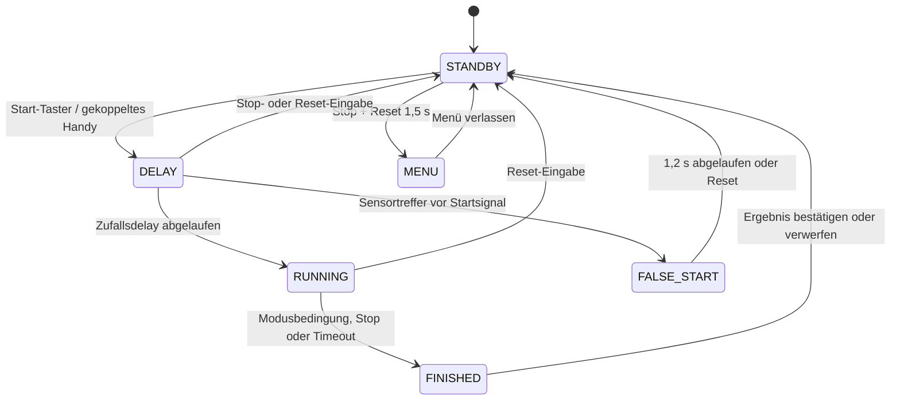

# EasySteel ESP32 Firmware

> 🌐 Sprache: [🇬🇧 English](../FIRMWARE.md) | **🇩🇪 Deutsch**

Dieses Dokument beschreibt Aufbau, Zustände und Bedienung der Firmware. Die elektrische Verdrahtung steht in [HARDWARE.md](HARDWARE.md), der verbindliche TCP-Vertrag in [PROTOCOL.md](PROTOCOL.md).

## 1. Systemgrenze

Der ESP32 ist das führende System für Rundenstatus, Startsignal, Zeitmessung, Treffer, Misses, Strafen, Ergebnisbestätigung und Reset. Eine Desktop-Anwendung darf Ereignisse anzeigen, bestätigte Ergebnisse speichern und deren Empfang quittieren. Sie darf keine laufende Runde fernsteuern. Ein physisch freigegebenes und per PIN gekoppeltes Handy ist eine getrennte Eingabequelle für Einzeltraining: Es darf Start, Stop, Reset und Modusänderungen in Standby anfordern, während der ESP32 jede Zustandsänderung prüft und ausführt.

Die Hardware bleibt ohne WLAN und ohne Desktop-Anwendung bedienbar. Netzwerkfehler dürfen die Zeitmessung nicht blockieren.

## 2. Firmware-Struktur

```text
.
├── include/
│   ├── core/       Round controller, scoring, display, menu and storage
│   ├── hardware/   Buttons, sensors, LEDs, buzzer and watchdog
│   └── network/    Wi-Fi, web/OTA, TCP protocol and queues
├── src/
│   ├── main.cpp
│   ├── core/
│   ├── hardware/
│   └── network/
├── test/           Native Unity tests and hardware mocks
├── docs/
└── platformio.ini
```

| Modul | Verantwortung |
|---|---|
| [`round_controller`](../../src/core/round_controller.cpp) | Rundenablauf, physische Bedienung, Trefferverarbeitung und Ergebnisfreigabe |
| [`round_state`](../../src/core/round_state.cpp) | Kleine, nativ testbare Zustandsübergänge einschließlich Fehlstart |
| [`scoring_rules`](../../src/core/scoring_rules.cpp) | Zielauswahl und Berechnung fehlender Zwischenziele |
| [`round_result`](../../src/core/round_result.cpp) | Genau einmal bestätigbares oder verwerfbares Ergebnis |
| [`training_result`](../../src/core/training_result.cpp) | Stabile flüchtige Snapshots für nicht autoritative, handy-lokale Einzeltrainingshistorie |
| [`sensor_isr`](../../src/hardware/sensor_isr.cpp) | Interrupts, Entprellung, Crosstalk-Sperre und chronologische Hitqueue |
| [`display`](../../src/core/display.cpp) | SH1106-Ausgabe, Splits, Menü und Bildschirmschoner |
| [`network`](../../src/network/network.cpp) | WLAN-Modi und Koordination von HTTP, OTA und TCP |
| [`remote_control`](../../src/network/remote_control.cpp) | Physische PIN-Freigabe, Ein-Handy-Session, PC-Priorität, Timeouts und begrenzter Command-Slot |
| [`tcp_client`](../../src/network/tcp_client.cpp) | Nicht blockierende Übertragung, Reconnect und Ergebnis-ACK |
| [`storage`](../../src/core/storage.cpp) | Persistente Geräteeinstellungen in ESP32 Preferences/NVS |

## 3. Runden-Zustandsmaschine



### STANDBY

- Zeigt Gerätename / Stage-Name, aktiven Rundenmodus, Bereit-Status und die letzte Runden- bzw. Reaktionszeit. Netzwerk- und IP-Diagnosedaten sind im Gerätemenü abrufbar (**Menü → Netzwerk** / **Menü → Info**).
- Start beginnt einen zufälligen Vorlauf von 1 bis 4 Sekunden.
- Ein gekoppeltes Einzeltrainings-Handy darf den Rundenmodus wählen oder Start anfordern. Start aus `FINISHED` verwirft das wartende offizielle Ergebnis und beginnt sofort den nächsten lokalen Trainingslauf.
- Stop und Reset gemeinsam für 1,5 Sekunden öffnen das Gerätemenü.
- Der Bildschirmschoner dimmt das OLED, ohne WLAN oder TCP zu trennen.

### DELAY und FALSE_START

- Beim Eintritt in `DELAY` werden die Sensoren bereits aktiviert.
- Ein Treffer vor dem Startsignal erzeugt `FALSE_START`, einen Warnton und die Anzeige `FEHLSTART`.
- Nach 1,2 Sekunden kehrt das Gerät automatisch nach `STANDBY` zurück.
- Stop oder Reset brechen den Vorlauf ab; Reset beendet auch die Fehlstartanzeige sofort.

### RUNNING

- Das Display zeigt Laufzeit, Fortschritt, Trefferanzahl und Zielmatrix.
- Grün oder Rot beendet die Runde manuell.
- Schwarz verwirft die aktive Runde und sendet ein `reset`-Ereignis.
- Nach 30 Sekunden endet die Runde automatisch.
- Ein Überlauf der Sensor-Hitqueue macht die Runde ungültig; die Firmware verwirft sie und sendet `reset`.

### FINISHED

Das Ergebnis bleibt zunächst ausschließlich auf dem Gerät zur Prüfung:

- Grün kurz: durch Gesamtzeit und chronologische Splits blättern.
- Grün lang: zurück zur Gesamtzeit.
- Rot kurz: Strafpunkte in 3-Sekunden-Schritten erhöhen; nach 10 wird auf die Mindeststrafe zurückgesetzt.
- Rot lang: Strafen auf die automatisch ermittelten Misses zurücksetzen.
- Schwarz kurz: Ergebnis bestätigen und genau ein `end`-Ereignis erzeugen.
- Schwarz lang: Ergebnis verwerfen und `reset` senden.
- Im Reaktions-Drill bestätigt Grün das Ergebnis und startet direkt den nächsten Versuch.

Die angezeigte Ergebniszeit einschließlich Strafen ist auf 30 Sekunden begrenzt. Läuft der konfigurierte Bildschirmschoner-Timeout in `FINISHED` ab, wird das unbestätigte Ergebnis verworfen und nach `STANDBY` gewechselt.

Für eine Runde, die bei gekoppeltem Einzeltrainings-Handy gestartet wurde, veröffentlicht der ESP32 eine stabile flüchtige Trainingsresultat-ID mit Roh-/Endzeit, Modus, Misses, Treffermaske und chronologischen Splits. Das Handy speichert jede ID genau einmal im LocalStorage. Mobiles Start beginnt den nächsten Lauf, mobiles Reset kehrt zu `STANDBY` zurück; keine der beiden Aktionen stellt das wartende Ergebnis in die offizielle Ergebnis-Outbox.

## 4. Rundenmodi

| Modus | Ende der Runde | Wertung |
|---|---|---|
| Wettkampf | Erster Treffer auf Stop Plate oder manueller Stopp | Nicht getroffene konfigurierte Zwischenziele werden als Misses gezählt |
| Alle Ziele | Alle konfigurierten Zwischenziele wurden getroffen und die Stop Plate ist der letzte Treffer | Keine automatische Miss-Strafe, da alle Ziele erforderlich sind |
| Reaktions-Drill | Erster Treffer auf einem angeschlossenen Sensor | Reaktionszeit bis zum ersten Treffer, keine Misses |

Index `0` ist die Stop Plate. Bei einer Zielanzahl von `5` sind die Indizes `1` bis `4` die vier Zwischenziele. Treffer außerhalb der konfigurierten Zielanzahl werden außerhalb des Reaktions-Drills ignoriert.

## 5. Treffererfassung

Alle fünf Sensoren arbeiten mit `RISING`-Interrupts. Die ISR führt nur begrenzte, zeitkritische Arbeit aus:

1. Zustand und Zielindex prüfen.
2. Wiederholte Zwischenzieltreffer außerhalb des Testmodus ignorieren.
3. 50 ms Entprellzeit pro Ziel anwenden.
4. 25 ms globale Crosstalk-Sperre anwenden.
5. Zielindex und `millis()`-Zeitstempel in eine statische FIFO mit 16 Einträgen schreiben.

Die Hauptschleife entnimmt Ereignisse chronologisch und übernimmt LED, Buzzer, Display, Scoring und Netzwerk. Volle Queue, verworfene Treffer und Queuezugriffe sind explizit behandelt; Display- oder Netzwerkcode läuft niemals in der ISR.

## 6. Netzwerk, Web und OTA

### Betriebsmodi

- **STA:** Das Gerät verbindet sich mit dem gespeicherten WLAN, stellt die authentifizierte Einstellungsseite bereit und arbeitet als TCP-Client.
- **AP+STA Provisioning:** Ohne gültige WLAN-Daten startet `EasySteel_XXXX` mit Captive Portal und Hintergrundscan.
- **Offline:** Während des Verbindungsversuchs kann mit Stop beziehungsweise im Provisioning nach der Boot-Sperrzeit in den Standalone-Betrieb gewechselt werden.

Der Standard-TCP-Port ist `53421`. Ereignisse und Bestätigungen sind in [PROTOCOL.md](PROTOCOL.md) beschrieben.

### Mobiles Einzeltraining

1. In `STANDBY` am ESP32 **Menü → Handy-Training** öffnen.
2. Das OLED zeigt 60 Sekunden lang eine vierstellige PIN.
3. Die PIN im Trainings-Dashboard eingeben. Fünf falsche Versuche schließen das Pairing-Fenster.
4. Genau ein Handy erhält ein ausschließlich im RAM gehaltenes Session-Token. Dashboard-Polling erneuert die 30-sekündige Inaktivitätsfrist.
5. Physische Eingaben löschen einen wartenden Handy-Befehl. Eine Desktop-Verbindung widerruft das Handy sofort; nach Trennung ist eine neue physische Freigabe erforderlich.

Das Dashboard erlaubt Start in `STANDBY` und `FINISHED`, Stop in `DELAY` und `RUNNING`, Reset in `DELAY`, `RUNNING` und `FINISHED` sowie die Moduswahl nur in `STANDBY`. HTTP-Handler prüfen und puffern genau einen begrenzten Befehl; der normale Round-Controller-Tick führt ihn aus. Ist **Beep** aktiviert, bildet das Handy den Übergang von `DELAY` zu `RUNNING` mit einem Startton nach. Durch das Polling kann dieser Ton bis zu einem Polling-Intervall verzögert sein; das tatsächliche Startsignal gibt deshalb der ESP32-Buzzer vor.

### Übertragungsverhalten

- Live-Ereignisse verwenden eine statische Sendewarteschlange mit 16 Einträgen und werden bei Trennung nicht dauerhaft gespeichert.
- Bestätigte Ergebnisse verwenden einen separaten RAM-Outbox-Puffer mit 20 Einträgen.
- Der Puffer ist flüchtig: Stromausfall oder Neustart löscht noch nicht zugestellte Ergebnisse.
- Bei vollem Ergebnis-Puffer ersetzt ein neues Ergebnis den ältesten Eintrag und erzeugt eine serielle Warnung.
- Pro Loop-Durchlauf erfolgt höchstens ein nicht blockierender Socket-Schreibversuch.

### Sicherheit und OTA

- Das Provisioning-Portal läuft nur auf dem passwortgeschützten Geräte-AP.
- Browser-OTA ist während des Provisionings deaktiviert.
- Einstellungen und Browser-OTA im STA-Modus verwenden HTTP Basic Auth mit Benutzer `admin` und Gerätepasswort.
- Die Einzeltrainings-Steuerung erfordert eine physische vierstellige PIN-Freigabe und anschließend ein starkes flüchtiges Session-Token; das Token gilt für genau ein Handy und wird niemals im NVS gespeichert.
- OTA wird nur in `STANDBY` verarbeitet.
- Watchdog und Sensorinterrupts werden während notwendiger Flashoperationen kontrolliert behandelt und auf Fehlerpfaden wiederhergestellt.

Basic Auth schützt ein vertrauenswürdiges lokales Netz, ersetzt aber weder TLS noch signierte Firmware.

## 7. Persistente Einstellungen

| Namespace | Schlüssel | Bedeutung |
|---|---|---|
| `wifi` | `ssid`, `pass` | WLAN-Zugangsdaten |
| `device` | `name`, `serverIp`, `port` | Gerätename und Desktop-TCP-Ziel |
| `easysteel` | `targets` | Konfigurierte Zielanzahl |
| `easysteel` | `require_all` | Kompatibilitätseinstellung für den Alle-Ziele-Modus |
| `easysteel` | `game_mode` | Persistenter Legacy-Schlüssel für den aktuellen Rundenmodus |
| `easysteel` | `screensaver` | OLED-Timeout in Minuten |

Der Schlüssel `game_mode` bleibt absichtlich erhalten, damit vorhandene Geräte ihre gespeicherte Einstellung nach der Umbenennung zum Round Controller behalten.

Reset beim Boot für zwei Sekunden löscht ausschließlich die WLAN-Zugangsdaten. Geräteeinstellungen und Rundenkonfiguration bleiben erhalten.

## 8. Zentrale Konstanten

| Konstante | Wert | Quelle |
|---|---:|---|
| `ROUND_TIMEOUT_MS` | 30.000 ms | [`config.h`](../../include/core/config.h) |
| `START_DELAY_MIN_MS` | 1.000 ms | `config.h` |
| `START_DELAY_MAX_MS` | 4.001 ms, exklusiv | `config.h` |
| `FALSE_START_DISPLAY_MS` | 1.200 ms | [`round_state.h`](../../include/core/round_state.h) |
| `SENSOR_DEBOUNCE_DELAY_MS` | 50 ms | `config.h` |
| `GLOBAL_CROSSTALK_LIMIT_MS` | 25 ms | `config.h` |
| `MENU_HOLD_MS` | 1.500 ms | `config.h` |
| `WIFI_CONNECT_TIMEOUT_MS` | 4.000 ms | `config.h` |
| Heartbeat | 10.000 ms | [`tcp_client.cpp`](../../src/network/tcp_client.cpp) |
| Reconnect | 15.000 ms | `tcp_client.cpp` |

## 9. Build und Qualitätssicherung

Aus dem Repository-Root:

```powershell
pio test -e native
pio run -e esp32dev
pio check -e esp32dev --skip-packages
```

Die nativen Tests decken Buttons, Sensor-ISR, chronologische Treffer, Rundenstatus, Miss-Zählung, Ergebnisfreigabe, Storage, Protokollserialisierung, Live-Sendewarteschlange und Ergebnis-Outbox ab.

Die erzeugte Firmware liegt unter `.pio/build/esp32dev/firmware.bin`.
