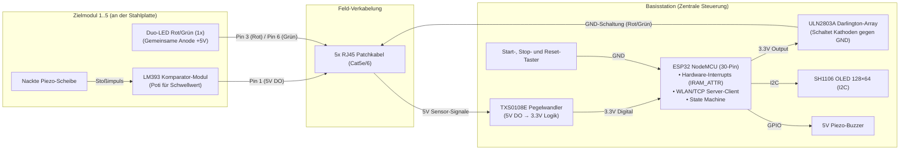

# EasySteel Hardware-Spezifikation

> 🌐 Sprache: [🇬🇧 English](../HARDWARE.md) | **🇩🇪 Deutsch**

Dieses Dokument ist die verbindliche Hardwarequelle für Basisstation, Zielmodule, Pinbelegung und Feldverkabelung. Abweichende ältere Übersichtszeichnungen sind nicht freigegeben.

> ⚠️ **WICHTIG VOR INBETRIEBNAHME:**
> Vor dem ersten Einschalten eine Multimeter-Prüfung auf Kurzschluss zwischen 5 V und GND durchführen. Danach ohne eingesetzten ESP32 prüfen, dass hinter dem Pegelwandler an keinem Sensoreingang mehr als 3,3 V anliegt. Niemals 5 V direkt auf einen ESP32-GPIO geben.

---

## 1. Systemarchitektur & Signalfluss

Das System besteht aus einer zentralen **Basisstation (ESP32 Steuerung)** und bis zu **5 Zielmodulen (Stahlplatten)**, die über Standard-**RJ45-Patchkabel** angebunden sind.



---

## 2. Stückliste (Bill of Materials)

### A. Basisstation (Zentrale Steuerung)

| Bauteil | Menge | Beschreibung / Spezifikation |
|---|:---:|---|
| **ESP32 NodeMCU** | 1x | 30-Pin Version mit Base-/Expansion-Board (Jumper auf 5V setzen) |
| **TXS0108E Modul** | 1x | 8-Kanal bidirektionaler Logic-Level-Shifter (ersetzt diskrete Spannungsteiler) |
| **ULN2803A IC** | 1x | 8-Kanal Darlington-Transistor-Array zur Masse-Schaltung (Low-Side) der LEDs |
| **RJ45 Breakout-Boards** | 5x | 8P8C RJ45-Buchsen für die Kabel zu den Zielen 1 bis 5 |
| **OLED Display** | 1x | SH1106, 128×64 Pixel, I2C, Adresse `0x3C`, 3,3-V-kompatibel |
| **Bedienelemente** | 3x | Drucktaster (Schließer/NO): Grün (Start), Rot (Stop/Strafe), Schwarz (Reset/Werten) |
| **Buzzer** | 1x | Aktiver 5V-Piezo-Summer (Startton und akustisches Feedback) |
| **Netzteil** | 1x | 9V / 12V DC Netzteil an Hohlstecker-Buchse des Base-Boards |

### B. Pro Zielmodul (Target 1 bis 5)

| Bauteil | Menge | Beschreibung / Spezifikation |
|---|:---:|---|
| **LM393 Sensor-Modul** | 1x | Komparator-Modul mit digitalem Ausgang (DO). *Hinweis: Original-Buzzer ablöten.* |
| **Nackte Piezo-Scheibe** | 1x | 20mm–27mm Piezo-Element, direkt auf die Buzzer-Pads des LM393 gelötet |
| **Duo-LED Rot/Grün** | 1x | **Gemeinsame Anode (Plus)**. Empfehlung: 10mm diffus (beste Sichtbarkeit auf Distanz) |
| **Vorwiderstand Rot** | 1x | **~100 Ω** für die rote Kathode |
| **Vorwiderstand Grün** | 1x | **~56 Ω** für die grüne Kathode |
| **RJ45 Breakout-Board** | 1x | Buchse im Zielgehäuse zum Anschluss des Patchkabels |

> **Hinweis zu den LED-Vorwiderständen:** `100 Ω` für Rot und `56 Ω` für Grün sind im bestehenden EasySteel-Referenzaufbau mit den dort verwendeten Duo-LEDs erprobte Werte. Bei einem anderen LED-Typ, einer anderen Charge oder einer geänderten Versorgung müssen Flussspannung und zulässiger Dauerstrom anhand des Datenblatts geprüft und der tatsächliche LED-Strom am aufgebauten Zielmodul gemessen werden. Die genannten Werte dürfen nicht ungeprüft auf beliebige LEDs übertragen werden.

---

## 3. RJ45 Steckerbelegung (Pro Port 1 bis 5)

Jedes Ziel ist über ein 8-adriges Standard-Netzwerkkabel (Cat5e / Cat6) mit der Basisstation verbunden:

```
                          RJ45 Buchse / Stecker
                       ┌─────────────────────────┐
                       │  1  2  3  4  5  6  7  8 │
                       └──┴──┴──┴──┴──┴──┴──┴──┴─┘
```

| RJ45 Pin | Aderfarbe (T568B) | Signal | Funktion & Verbindung |
|:---:|---|---|---|
| **Pin 1** | Weiß / Orange | **Sensor-Signal (5V DO)** | Digitaler Ausgang vom LM393 $\rightarrow$ TXS0108E (B-Kanal) |
| **Pin 2** | Orange | **GND** | Gemeinsame Masse (mit Pin 7+8 gebrückt) $\rightarrow$ LM393 GND |
| **Pin 3** | Weiß / Grün | **Rot-Signal (Kathode)** | Geschaltete Masse über ULN2803A OUT 1 $\rightarrow$ Vorwiderstände (~100Ω) $\rightarrow$ Rote Kathoden |
| **Pin 4** | Blau | **+5V Versorgung** | Gemeinsames Plus (mit Pin 5 gebrückt) $\rightarrow$ LM393 VCC & Gemeinsame LED-Anoden |
| **Pin 5** | Weiß / Blau | **+5V Versorgung** | Brücke zu Pin 4 (für höhere Strombelastbarkeit) |
| **Pin 6** | Grün | **Grün-Signal (Kathode)** | Geschaltete Masse über ULN2803A OUT 2..6 $\rightarrow$ Vorwiderstände (~56Ω) $\rightarrow$ Grüne Kathoden |
| **Pin 7** | Weiß / Braun | **GND** | Brücke zu Pin 2 |
| **Pin 8** | Braun | **GND** | Brücke zu Pin 2 |

---

## 4. Schaltpläne & Verdrahtung

### 4.1 Zielmodul (Verdrahtung an der Stahlplatte)

```
======================================================================
RJ45 [Pin 4+5 gebrückt] (+5V)
 │
 ├───> LM393 Modul [VCC-Pin]
 └───> [Duo-LED Anode / Gemeinsamer Pin +]

RJ45 [Pin 2+7+8 gebrückt] (GND)
 │
 └───> LM393 Modul [GND-Pin]

RJ45 [Pin 1] (Sensor DO)
 │
 └───> LM393 Modul [DO-Pin]  (Piezo-Scheibe auf Buzzer-Pads gelötet)

RJ45 [Pin 3] (Rot-Signal von ULN2803A)
 │
 └───> [ ~100 Ω ] ───> [Duo-LED Kathode Rot -]

RJ45 [Pin 6] (Grün-Signal von ULN2803A)
 │
 └───> [ ~56 Ω ] ───> [Duo-LED Kathode Grün -]
======================================================================
```

---

### 4.2 Basisstation

#### 1. Sensor-Pegelwandlung mit TXS0108E (Ersetzt Spannungsteiler)

Der aktuelle Aufbau führt die fünf digitalen 5-V-Ausgangssignale der LM393-Module über einen TXS0108E auf die 3,3-V-Eingänge des ESP32. Vor Anschluss des ESP32 muss die Ausgangsspannung jedes verwendeten Kanals gemessen werden:

```
  5V-Versorgung ──────────> TXS0108E VCCB (5V Seite)
  3.3V (ESP32 3V3) ───────> TXS0108E VCCA (3.3V Seite)
  3.3V (ESP32 3V3) ───────> TXS0108E OE   (Output Enable aktiviert)
  GND-Schiene ────────────> TXS0108E GND

  5V-Signale von Zielen           TXS0108E Shifter        3.3V-Eingänge am ESP32
  ─────────────────────           ────────────────        ──────────────────────
  RJ45 Port 1 [Pin 1] (Stop) ───> B1 ─────── A1 ────────> ESP32 Pin 32 (Stop Plate)
  RJ45 Port 2 [Pin 1] (Ziel 2) ─> B2 ─────── A2 ────────> ESP32 Pin 33 (Sensor 2)
  RJ45 Port 3 [Pin 1] (Ziel 3) ─> B3 ─────── A3 ────────> ESP32 Pin 25 (Sensor 3)
  RJ45 Port 4 [Pin 1] (Ziel 4) ─> B4 ─────── A4 ────────> ESP32 Pin 26 (Sensor 4)
  RJ45 Port 5 [Pin 1] (Ziel 5) ─> B5 ─────── A5 ────────> ESP32 Pin 27 (Sensor 5)
```

#### 2. LED- & Buzzer-Treiber (ULN2803A)

Der ULN2803A schaltet die Kathoden der LEDs und des Buzzers gegen Masse, sobald der ESP32 den jeweiligen Pin auf `HIGH` setzt:

```
  GND-Schiene ────────────> ULN2803A Pin 9  (GND)
  5V-Schiene ─────────────> ULN2803A Pin 10 (COM / Freilauf-Dioden)

  ESP32 Steuersignal              ULN2803A Treiber        Ausgang zur Ziel-Verkabelung
  ──────────────────              ────────────────        ────────────────────────────
  ESP32 Pin 4  (Global-Rot) ────> IN 1 ──── OUT 1 (P18) ─> ALLE RJ45 Ports 1 bis 5 [Pin 3]
  ESP32 Pin 19 (Grün Ziel 1) ───> IN 2 ──── OUT 2 (P17) ─> RJ45 Port 1 [Pin 6]
  ESP32 Pin 18 (Grün Ziel 2) ───> IN 3 ──── OUT 3 (P16) ─> RJ45 Port 2 [Pin 6]
  ESP32 Pin 5  (Grün Ziel 3) ───> IN 4 ──── OUT 4 (P15) ─> RJ45 Port 3 [Pin 6]
  ESP32 Pin 17 (Grün Ziel 4) ───> IN 5 ──── OUT 5 (P14) ─> RJ45 Port 4 [Pin 6]
  ESP32 Pin 16 (Grün Ziel 5) ───> IN 6 ──── OUT 6 (P13) ─> RJ45 Port 5 [Pin 6]
  ESP32 Pin 23 (Buzzer) ────────> IN 7 ──── OUT 7 (P12) ─> Buzzer (-) Kathode
```

> **Buzzer am ULN2803A (Kanal 7):** Vorgesehen ist ein aktiver 5-V-Buzzer. Seine Anode liegt an der abgesicherten 5-V-Schiene, die Kathode wird über den ULN2803A geschaltet. Passive Lautsprecher und 12-V-Signalgeber gehören nicht zur freigegebenen Standardkonfiguration. Stromaufnahme und Gesamtverlustleistung müssen zum konkreten Buzzer, Treiber und Netzteil passen.

#### 3. Taster & Display

```
  ESP32 Pin 14 ───────────> Taster 1 (Start / Grün) ─────────> GND-Schiene (Active LOW)
  ESP32 Pin 12 ───────────> Taster 2 (Stop/Strafe / Rot) ────> GND-Schiene (Active LOW)
  ESP32 Pin 13 ───────────> Taster 3 (Reset/Werten / Schwarz) > GND-Schiene (Active LOW)

  ESP32 Pin 21 (SDA) ─────> OLED Display SDA
  ESP32 Pin 22 (SCL) ─────> OLED Display SCL
  3.3V / GND ─────────────> OLED Display VCC / GND
```

---

## 5. ESP32 Pinbelegungs-Gesamtübersicht

```
                         ┌───────────────┐
                         │     ESP32     │
                         │    30-Pin     │
                         │               │
                   EN ── [   EN     D23  ] ─→ ULN2803A IN 7 (Buzzer)
                 (VP) ── [   VP     D22  ] ─→ OLED SCL (I²C)
                 (VN) ── [   VN     TX0  ] ── (Serial TX Debug)
              (frei) ── [  D34     RX0  ] ── (Serial RX Debug)
              (frei) ── [  D35     D21  ] ─→ OLED SDA (I²C)
 (TXS A1 / Port 1) IO32 ←─ [  D32     D19  ] ─→ ULN2803A IN 2 (LED Grün 1)
 (TXS A2 / Port 2) IO33 ←─ [  D33     D18  ] ─→ ULN2803A IN 3 (LED Grün 2)
 (TXS A3 / Port 3) IO25 ←─ [  D25      D5  ] ─→ ULN2803A IN 4 (LED Grün 3)
 (TXS A4 / Port 4) IO26 ←─ [  D26     D17  ] ─→ ULN2803A IN 5 (LED Grün 4)
 (TXS A5 / Port 5) IO27 ←─ [  D27     D16  ] ─→ ULN2803A IN 6 (LED Grün 5)
     (BTN Start)  IO14 ←─ [  D14      D4  ] ─→ ULN2803A IN 1 (LED Global-Rot)
      (BTN Stop)  IO12 ←─ [  D12      D2  ] ── Built-in LED (Heartbeat)
     (BTN Reset)  IO13 ←─ [  D13     D15  ] ── (frei)
                  GND ── [  GND     GND  ] ── Gemeinsame Masse (GND)
                   5V ── [  VIN     3V3  ] ── 3.3V Ausgang (zu TXS VCCA & OLED)
                         │               │
                         │   [  USB  ]   │
                         └───────────────┘
```

| Pin | Richtung | Funktion | Gegenstelle / Verbindung |
|:---:|:---:|---|---|
| **GPIO 32** | Input (ISR) | **Sensor 1 (Stop Plate)** | TXS0108E A1 $\leftarrow$ B1 $\leftarrow$ RJ45 Port 1 [Pin 1] |
| **GPIO 33** | Input (ISR) | **Sensor 2** | TXS0108E A2 $\leftarrow$ B2 $\leftarrow$ RJ45 Port 2 [Pin 1] |
| **GPIO 25** | Input (ISR) | **Sensor 3** | TXS0108E A3 $\leftarrow$ B3 $\leftarrow$ RJ45 Port 3 [Pin 1] |
| **GPIO 26** | Input (ISR) | **Sensor 4** | TXS0108E A4 $\leftarrow$ B4 $\leftarrow$ RJ45 Port 4 [Pin 1] |
| **GPIO 27** | Input (ISR) | **Sensor 5** | TXS0108E A5 $\leftarrow$ B5 $\leftarrow$ RJ45 Port 5 [Pin 1] |
| **GPIO 4**  | Output | **Global-Rot LED** | ULN2803A IN 1 $\rightarrow$ OUT 1 $\rightarrow$ ALLE RJ45 [Pin 3] |
| **GPIO 19** | Output | **Grün LED Ziel 1** | ULN2803A IN 2 $\rightarrow$ OUT 2 $\rightarrow$ RJ45 Port 1 [Pin 6] |
| **GPIO 18** | Output | **Grün LED Ziel 2** | ULN2803A IN 3 $\rightarrow$ OUT 3 $\rightarrow$ RJ45 Port 2 [Pin 6] |
| **GPIO 5**  | Output | **Grün LED Ziel 3** | ULN2803A IN 4 $\rightarrow$ OUT 4 $\rightarrow$ RJ45 Port 3 [Pin 6] |
| **GPIO 17** | Output | **Grün LED Ziel 4** | ULN2803A IN 5 $\rightarrow$ OUT 5 $\rightarrow$ RJ45 Port 4 [Pin 6] |
| **GPIO 16** | Output | **Grün LED Ziel 5** | ULN2803A IN 6 $\rightarrow$ OUT 6 $\rightarrow$ RJ45 Port 5 [Pin 6] |
| **GPIO 23** | Output | **Piezo-Buzzer** | ULN2803A IN 7 $\rightarrow$ OUT 7 $\rightarrow$ Buzzer (-) |
| **GPIO 14** | Input (Pullup) | **Start-Taster (Grün)** | Taster Grün $\rightarrow$ GND |
| **GPIO 12** | Input (Pullup) | **Stop/Strafe-Taster (Rot)** | Taster Rot $\rightarrow$ GND |
| **GPIO 13** | Input (Pullup) | **Reset/Commit-Taster (Schwarz)**| Taster Schwarz $\rightarrow$ GND (Deep Sleep Wakeup) |
| **GPIO 21** | I2C | **OLED SDA** | Display SDA |
| **GPIO 22** | I2C | **OLED SCL** | Display SCL |

---

## 6. Elektrische Auslegung und Abnahme

Vor einem Feldeinsatz müssen mindestens folgende Punkte geprüft und protokolliert werden:

1. Durchgangs- und Kurzschlussprüfung aller 5-V-, 3,3-V- und GND-Schienen.
2. Messung jedes TXS0108E-Ausgangs ohne eingesetzten ESP32; maximal 3,3 V am GPIO-Anschluss.
3. Gemeinsame Masse zwischen Netzteil, Basisstation und allen Zielmodulen.
4. Je ein eigener Vorwiderstand für die rote und die grüne Kathode der Duo-LED.
5. Stromaufnahme jedes Zielmoduls sowie Gesamtstrom bei maximal gleichzeitig leuchtenden LEDs messen.
6. Netzteil, Zuleitung, Steckverbinder und Leiterbahnen mit ausreichender Reserve dimensionieren und die 5-V-Verteilung passend absichern.
7. RJ45-Leitungen eindeutig als EasySteel-Feldverkabelung kennzeichnen. Sie führen Versorgung und GPIO-Signale und dürfen nicht mit Ethernet-Geräten verbunden werden.
8. Zugentlastung, Berührungsschutz und Schutz gegen Treffer, Feuchtigkeit und vertauschte Steckverbindungen prüfen.
9. Sensorpegel, Flankenform und Fehlauslösungen mit der tatsächlich vorgesehenen maximalen Kabellänge testen.

Die Strombelastbarkeit eines einzelnen ULN2803A-Kanals darf nicht isoliert als zulässiger Gesamtstrom des Bausteins interpretiert werden. Maßgeblich sind Datenblatt, Anzahl gleichzeitig aktiver Kanäle, Versorgung, Umgebungstemperatur und Kühlung des konkreten Aufbaus.

## 7. Noch zu ergänzende Fertigungsunterlagen

Für eine veröffentlichungsreife Bauanleitung fehlen weiterhin:

- geprüfter Stromlaufplan statt einer vereinfachten Anschlussgrafik;
- Platinen- oder Lochrasterplan mit Steckverbinderbezeichnungen;
- Kabelplan für beide RJ45-Enden und dokumentierte T568B-Prüfung;
- Gehäusezeichnungen, Zugentlastung und mechanischer Trefferschutz;
- festgelegte maximale Kabellänge und Abnahmekriterien;
- Fotos eines geprüften Referenzaufbaus;
- Stückliste mit konkreten Herstellerteilen oder belastbaren Mindestanforderungen.
